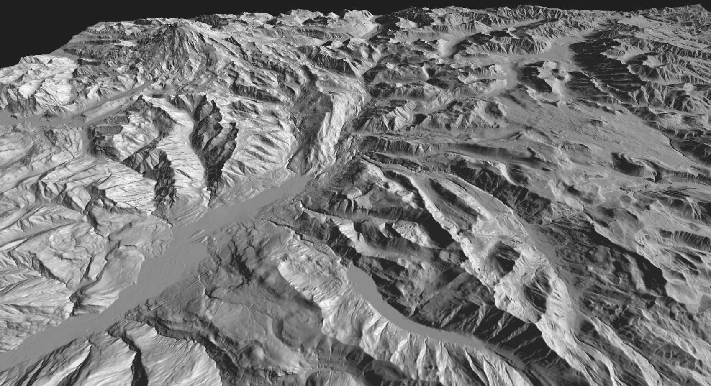

# Assignment 3: Lighting and Shading

The goal of this assignment is to get you comfortable with lighting and shading effects. Skills that you will learn include: using index buffers to load/represent geometry, computing accurate normal vectors, and calculating per-pixel lighting effects. Similar to the last assignment, you will use height map data to create a terrain mesh. You will then create shaders to implement the Phong lighting model to shade the terrain. Interactions should include the ability to pan, rotate, and zoom into the model (based on assignment 2). Additional controls should allow you to manipulate the direction/position of the light, switch between a directional and a point light source, and switch between showing the surface normals or shading the surface according to the incident light. 

Here is a list of tasks that you need to implement:

## Task 1

Load the mesh from both image  and .BSQ heightmap files. The latter is essentially a raw dump of Float32Array data (see the starter code). The BSQ files in particular  (i've included two Mnt. Rainier examples) provide a much higher (32-bit) height resolution than images (typically limited to 8-bit), allowing for better image quality. For uploading the mesh data to the GPU, this time you should utilize index and vertex buffers. The use of index buffers avoids the need to duplicate vertices that are shared by multiple triangles. This is important as we will be loading increasingly complex meshes in this assignment, as well as including additional vertex attributes (normals, specifically). As part of task 1, you will also implement pan, rotate, and zoom functionalities using mouse input. As in the last assignment, the user should also be able to control the height of the terrain through a slider interactively.  

## Task 2

Compute surface normals. For each triangle in the mesh, you will be computing a normal vector, and then assigning that to the corresponding vertices that make up the triangle. Note that some vertices will be shared among multiple triangles in the mesh. The normal at those shared vertices should be averaged (and normalized) to reflect the mean normal of all triangles intersecting the vertex.  Normals should be uploaded as a vertex attribute to be utilized by the shader. You also need to ensure that normals are transformed accurately as you manipulate or stretch the model. Pay attention to the effects of increasing/decreasing the terrain height through the slider, which is a non-uniform scale operation that requires a special-case normal transform matrix. 

## Task 3

Color the mesh by surface normals: Instead of showing the XYZ coordinate in RGB color (as we did in assignment 2), you will be showing the value of the computed normal at the vertex. This will be very handy for debugging, to ensure that you are computing (and then transforming) surface normals accurately. 

## Task 4

Shade the terrain using the Phong model according to the incident light. You should implement a per-pixel illumination model using a fragment shader. Your UI should include a radio button to switch between Phong shading and showing surface normals (Task 3).

## Task 5

Add controls/sliders to allow you to control the direction of the light. This should consist of two sliders that allow you to manipulate the X and Z of the incident light. You can maintain a constant Y direction (e.g., +1), and assume that the light will always be coming from the top, but allow the user to bias it left-right and/or front-back. 

## Task 6 (optional for undergrads, mandatory for grads)

Switch between a directional (default) or point light via a radio button. If in the latter mode, the light-control sliders should change the position (source point) of the light rather than the direction. 

## Grading rubric
- If you complete task 1 only: E
- If you complete tasks 1-2: D
- Tasks 1-3: C
- Tasks 1-4: B
- Tasks 1-5: A (grad students also need to complete task 6 to get A)
